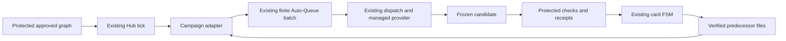

# Protected Campaign execution

Campaign remains the goal ledger. `server/campaign_execution` adapts an
operator-approved graph into finite batches in the existing Auto-Queue. The
existing dispatcher, managed provider adapter, protected checker and card FSM
remain the only execution and completion authorities.



The server adapter owns sequencing and progress projection. `db/campaigns/handoff`
owns atomic batch publication. `services/managed_checks` owns the shared protected
contract and workspace binding used by both dispatch creation paths. The checker
keeps artifact certification and finite rework in separate modules. No new goal
table, execution queue, provider loop or completion authority is introduced.

This is an opt-in Linux read/edit profile. An ordinary active Campaign remains
a ledger until its ID appears in `AGENTDESK_CAMPAIGN_REGISTRY`. The registry and
`AGENTDESK_CHECK_REGISTRY` use the same root-owned 0600 protected-file reader.
Current execution requires a provider with managed protocol version 1 and an
agent with finite `execution_limits`. Adapter support is checked from the
provider registry; the presence of a general-purpose CLI is insufficient.

## Operator contract

Each node has a globally unique logical `task_key`, a dedicated check template
with its own private workspace, and explicit predecessor file mappings. A key
is consumed once; neither another Campaign nor a later batch can silently
repeat it. Repeating a business task requires a newly approved task key.

```json
{
  "approved-goal-id": {
    "graph_digest": "SHA256_OF_CANONICAL_APPROVED_GRAPH",
    "repo": "owner/repository",
    "agent_id": "managed-agent-id",
    "nodes": {
      "a": {
        "task_key": "feature-a-v1",
        "check_template": "feature-a",
        "auto_rework": true,
        "inputs": []
      },
      "b": {
        "task_key": "feature-b-v1",
        "check_template": "feature-b",
        "auto_rework": true,
        "inputs": [
          {"dependency": "a", "source": "answer.txt", "destination": "input/a.txt"}
        ]
      }
    }
  }
}
```

The Campaign DAG must declare `b.dependencies = ["a"]`. Every dependency needs
at least one real file mapping. Paths are relative, unique and cannot traverse
outside the workspace. An input destination cannot appear in the template's
`allowed_changes`. Human review and no additional review are supported by this
profile; local Git review needs a separately verified adapter and is rejected.

To calculate `graph_digest`, export the authenticated Campaign response to a
JSON file and canonicalize its work instructions as follows. This command only
prepares a digest; installing the protected registry is the operator approval.

```python
import hashlib, json
from pathlib import Path
c = json.loads(Path("campaign.json").read_text())["campaign"]
graph = {k: c[k] for k in ("title", "description", "round")}
graph["nodes"] = {
    n["id"]: dict(
        **{k: n[k] for k in ("title", "stage", "round", "details", "acceptance")},
        dependencies=sorted(n["dependencies"]),
    ) for n in c["nodes"]
}
print(hashlib.sha256(json.dumps(graph, sort_keys=True, separators=(",", ":"),
                                ensure_ascii=False).encode()).hexdigest())
```

After the first task is supplied, database guards preserve graph instructions,
task identity, input manifest, assignment and execution policy. Progress,
pause/cancel and operator approval remain available. Paused/cancelled goals
admit no new implementation, rework or review dispatch and cannot promote a
pending dispatch to running. An already-running provider retains its finite
deadline and termination contract; a Campaign status edit is not proof that
the provider has stopped.

## Execution and recovery

1. The existing 30-second tick loads the protected plan. Configuration mismatch
   holds supply; it does not start a replacement runner or scheduler.
2. Independent ready nodes are prepared under the existing `managed-capture`
   resource reservation, which excludes retained and live execution leases.
3. A completed predecessor must still satisfy the protected completion predicate.
   Its root-owned frozen files are rehashed before handoff. Model text, a ledger
   completion status and a caller-supplied digest cannot certify a result.
4. Selected files are prepared outside the workspace in private, protected
   staging and committed using atomic `renameat2(RENAME_NOREPLACE)`. Workspaces
   and protected artifacts must share a filesystem. Interrupted staging is
   replayed before publication and never appears as a partial workspace input.
   Existing identical inputs support retry; conflicting bytes are never replaced.
   The successor's contract includes these input hashes in its immutable baseline.
5. Cards, contracts and one finite generated Auto-Queue batch commit together.
   Canonical activation creates the dispatch and uses the enrolled workspace.
   A missing workspace fails; it cannot fall back to another repository.
6. The checker owns receipts and the FSM owns `done`. With `auto_rework: true`,
   failed assertions may create a deterministic rework dispatch, bounded by
   `max_candidates`. Unknown writers and unverifiable checks hold for attention.
   Independent ready branches continue; blocking reasons appear on Campaign nodes.
7. Reconciliation reads persisted cards, batches and receipts after restart.
   A successor gets a new batch; finished batches are never extended. A goal
   completes only after every node has a protected completed artifact.

Input trees are bounded by the checker manifest limit (4096 entries/32 MiB),
each successor by 64 mappings and 32 MiB of selected bytes, and each published
batch by 16 tasks. File I/O runs outside database transactions. A publication
whose reservation expired fails and can be retried safely.

## Validation boundary

`scripts/probe_campaign_execution.py` exercises the real Hub, authenticated
Campaign creation, automatic tick, canonical queue/dispatch, real predecessor
files, checker subprocesses, bounded rework, FSM completion and restart. The
implementation outputs are deliberately injected fixtures. This does not prove
a real model completed the task or that the deployment ran for 24 hours.

```sh
python3 scripts/probe_campaign_execution.py \
  --binary /target/debug/agentdesk \
  --artifact-dir target/24x7-native/campaign-execution-unique-run
```

The harness only accepts the disposable PostgreSQL container/loopback port 44620,
creates a private DB and configuration root, and removes its own DB afterwards.
Artifact directories are exclusive so earlier failures remain available.

Real provider stop/containment after an unknown remote effect, generalized build
adapters, deployment bundle/OS-service recovery and a measured 24-hour run remain
separate operational acceptance requirements in `OPERATING-READINESS.md`.
