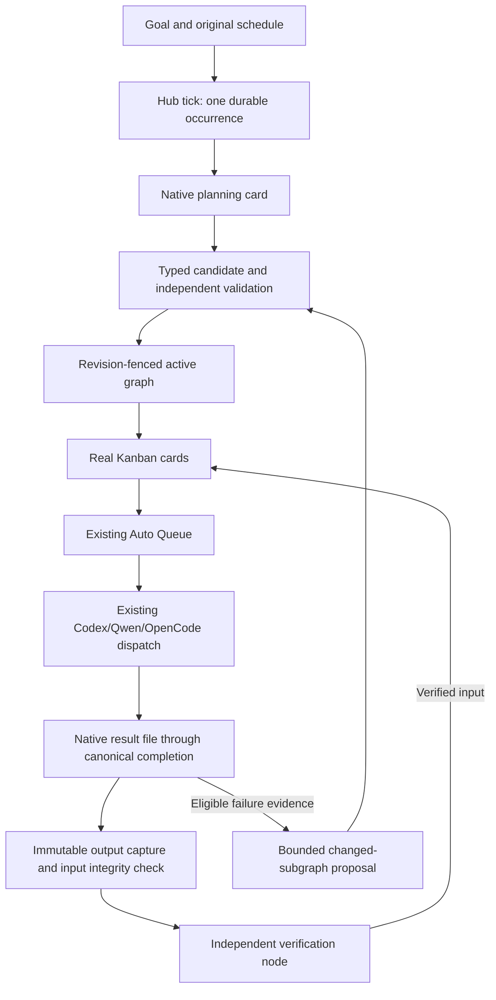

# Hive patterns adapted to native Campaign execution

Initial source basis: the user-supplied `D:\P4\hive` tree, inspected on
2026-09-29 KST. On 2026-10-03 KST, the supplied
`C:\Users\12336\Desktop\hive-main.zip` was checked directly. Its SHA-256 is
`baad4af8cf4f196b2f821eb15858aa24e343ee4f26d19c19a410480dfb5b6466`.
All five originally inspected implementation files match the ZIP byte for byte.
Neither source establishes upstream HEAD parity. Initial receipts are in
`target/24x7-native/campaign-graph-v15/hive-source-files.json`; the new ZIP,
modern architecture/code comparison and inspection ranges are in
`target/24x7-native/high-roi-v20/hive-reference-audit.json`.
No Hive implementation code is copied. AgentDesk keeps its native executor,
PostgreSQL, Campaign ledger, Kanban FSM, Auto Queue and dispatch completion owner.

## Reference patterns and implementation

| Priority | Hive reference | AgentDesk adaptation |
|---|---|---|
| P0 | `core/framework/orchestrator/goal.py`: objective, success criteria, constraints, evolution reason | `db/campaigns/graph.rs`: immutable typed Goal, finite budget, enrolled Codex/Qwen/OpenCode identities |
| P0 | `core/framework/orchestrator/edge.py`: source/target and input mapping | Agent-authored DAG with actual bounded output files and per-edge source/destination mappings; reject cycles, missing outputs, path escapes and self verification |
| P0 | Runtime observations | Captured failure records correlate goal/version/task/card/dispatch/provider and hashes; external effects are not classified as safely replayable merely because a provider says code error |
| P1 | Goal version/evolution metadata | Persisted candidate → validated → active → superseded/rejected graph versions; independent validation, revision CAS, atomic activation, bounded changed-subgraph planning |
| P1 | Goal-driven graph construction | The planner writes the graph, including each node's coding/check requirements. Generated code must pass an independent verifier before downstream business work consumes it. Graph activation approves a plan, not code that has yet to be generated. |
| P2 | `agent_loop/internals/stall_detector.py` | Observe actual provider tool IDs and hashed arguments/results; eight identical completed tool observations trigger bounded cancellation and an unknown-effect hold |
| P2 | `agent_loop/internals/cursor_persistence.py`, `agents/queen/worker_definition.py` | PostgreSQL retains observed tool count, cumulative dispatch lifetime, task and evolution budgets across graph revisions/restarts |

## One execution owner

Migration `0135_campaign_graph_runtime.sql` adds contracts and observations, not
another execution queue. Publication of a card, binding and finite queue entry is
one transaction. A database trigger rejects unregistered executors, paused or held
goals, obsolete graph tasks, terminal-attempt replay and duplicate work attempts.

The normal coding completion path remains intact. Only graph-bound native tasks
can submit `.agentdesk-campaign-result.json` from their canonical workspace.
The completion owner checks the workspace, bounded file, freshness and reserved
fields. It stores provider output through the existing finalizer. Receipt storage
is not business acceptance: the collector validates observations and actual declared
artifacts before authorizing canonical card completion and dependent publication.

The native contract is loaded from canonical `campaign_graph_tasks` membership
and the bound card description at provider intake. It does not trust a dispatch
context flag to waive ordinary PR rules. Bound tasks receive the complete goal,
graph schema or node requirements, plus the file-based completion contract.
Ordinary cards retain their existing PR and completion API contract. User-derived
goal text stays in the redacted current-task manifest layer, not the fully logged
ADK-owned contract layer.

Deadline cancellation passes the live health registry to the existing Auto Queue
cleanup owner. Before releasing slots, its durable cleanup job stops only terminal
graph dispatches with a matching local inflight dispatch identity, using the existing
force-kill lifecycle. Ordinary reusable sessions and successor turns are excluded.
Failed cleanup keeps the durable job pending. Merely clearing database rows or
passing the registry was insufficient: the general slot recycler deliberately
preserves active/reusable sessions and left a retried Qwen child alive in live testing.
Unknown/infrastructure failures retain explicit holds. Terminal dispatches lacking
`completed_at` use canonical `updated_at` for cumulative lifetime instead of
continuing to consume budget indefinitely.

Captured output and verified output are different. Unverified `artifact_only`
producers may be replaced after failed checks. Verified artifacts, in-flight work
and external-effect contracts remain pinned. Activation rechecks these pins, so a
late verification settlement cannot be lost between candidate staging and activation.
Rollback selects a previously validated graph; it never undoes a completed external
effect or silently forgets a verified task.

Schedules use a stable goal and durable occurrence rows. They preserve original
local-time slots, coalesce missed slots, reject duplicate occurrence admission and
do not overlap active/paused occurrences. Historically paused routines are excluded.
The Python `campaign_ops` command only enrolls the six eligible goals once; it is
not installed as a scheduler, coordinator or model runner.

## Recurring graph reuse decision

The versioned template lifecycle is implemented in migrations 139–141. The
family's first graph uses the configured superior, subsequent initial graphs use
the enrolled planner, and each N new verified completed occurrences triggers a
superior review including the current template. Promoted templates instantiate
fresh candidate graphs and task identities; independent graph approval and fresh
business evidence are required for every occurrence. Rejected or incompatible
templates allow bounded planning. Changed-subgraph recovery preserves verified
inputs and external-effect contracts. See
[CAMPAIGN-DAG-TEMPLATES.md](CAMPAIGN-DAG-TEMPLATES.md) for the full contract.
The implementation is tested; the health family's first production promotion
still requires ten actual verified samples. A template in a fixture does not
establish a production promotion.

Reuse must separate three identities: stable template node, occurrence execution,
and business-effect idempotency key. Copying old task keys or completion receipts
into a new occurrence is not graph reuse. The current global task-key ownership
guard must remain intact until explicit template instantiation models these
identities. Repeated observations need new execution identities; an already
merged PR must remain the same business effect across retries and occurrences.

| Goal | Reusable procedure | Fresh or replanned work |
| --- | --- | --- |
| Health | Inspect services, queues and independent check | Current observations; incident-specific diagnosis |
| Skills | Discover changes, sync, validate | Changed skill set and compatibility work |
| Upstream | Compare upstream, integrate, test | Current commits and conflict resolution |
| AgentDesk review | Fetch diff, analyze, select tests, verify | Current PR head, changed code and relevant tests |
| AgentDesk merge | Recheck eligibility and exact head, merge, verify | Current checks, approvals and merge state |
| Monolith | Review and validation procedure | Current change scope and dependency impact |

Match reusable procedures against canonical goal/constraint/acceptance and
capability contracts, not every new repository commit. Bind fresh repository/PR
inputs at instantiation. Independently validate changed graph versions before
promotion; routine instantiation still checks structural validity, eligibility,
artifact contracts and freshness. Never promote PR-specific IDs or incident
workarounds into a reusable procedure. Unknown external effects and provider
failures require reconciliation or recovery, not speculative graph regeneration.

Measure planner/verifier invocations, acceptance rate, elapsed time, observed
tool use, reused nodes and duplicate-effect prevention before claiming optimal
ROI. The installed health parent runs at 04:00, 10:00, 16:00 and 22:00 KST;
the original 30-minute routine is historical and is not the current schedule.

## Direct ZIP architecture comparison: 2026-10-03 KST

The earlier review directly inspected five relevant implementation files. It
did not establish exhaustive review of the archive's 2,812 entries. The direct
ZIP pass additionally examined the architecture and worker documentation,
playbook convergence/retry code, immutable colony binding, judge pipeline,
worker lifetime/grace budgets and reminder lifecycle points.

The ZIP contains both the older graph modules and a modern colony architecture.
Its current architecture document describes a persistent Queen, worker clones,
tracker and deterministic playbooks rather than a graph executor. AgentDesk's
requested JSON DAG remains its execution contract. The transferable mechanisms
below are compared against the existing native implementation; this comparison
does not claim they were originally implemented by importing those modern files.

| Inspected Hive mechanism | Native behavior and evidence | Boundary |
|---|---|---|
| `host/playbook/runner.py:305`: re-query unfinished rows, bounded rounds, convergence and remaining work | Campaign controller reads durable PostgreSQL graph/task/accepted-receipt state; schedule admission and learning collection are idempotent | Keep the existing Hub/Auto Queue owner; no second Python execution engine |
| `host/playbook/runner.py:191`: avoid blind retry of a completed non-idempotent action | External/unknown outcomes retain holds; audited artifact-only recovery preserves old receipts, usage and accepted producer inputs | A failed receipt is not permission to repeat a merge, send or other external effect |
| `host/colony_binding.py:28`: one immutable binding, refuse absent identity | Canonical campaign/task/card membership, pinned contract digests, literal artifact paths and workspace ownership checks | Do not infer ownership from provider prose or loose session identifiers |
| `agent_loop/internals/judge_pipeline.py:42`: output checks plus semantic judge feedback | Typed schema and structural checks, captured input/output integrity, independent plan approval and business verification | Planning approval and worker self-report are insufficient for sample collection |
| Architecture pilot → skill/playbook and `worker_definition.py:51`: tighter worker lifetime budgets | Superior bootstrap followed by enrolled planners, N-sample template review, and separately persisted parent-control/occurrence budgets in migration 141 | The N-sample policy is the user's AgentDesk policy, not a Hive API; no ten-sample production claim before those runs complete |
| Architecture tool-result pointers/spillover | Bounded immutable output bundles and edge input mappings carry hashes and fresh evidence between native tasks | Reuse structure without copying old acceptance or execution identity |
| `agent_loop/reminders.py:48`: lifecycle attention and grace reporting | Current task contracts are republished at native dispatch; observer records actual health, holds, sample/review and deployment identity every five minutes | Hive's in-loop reminder/grace interception is not implemented for encapsulated Codex/Qwen/OpenCode CLIs; observed tool counts are not a pre-tool enforcement hook |

Current implementation validation and installation are recorded under
`target/24x7-native/high-roi-v20/`: 370 selected Rust regressions, seven isolated
native boots, the migration-141 deployment receipt, audited budget/recovery
requests and a separate read-only observer installation. Production business
completion, N-sample promotion and measured 24-hour continuity remain separate
evidence levels. The observer never grants full acceptance merely because time
passes.

## Deliberate operational limits

- Native CLI constraints and `artifact_only` are execution contracts, not OS containment.
- Tool budgets are based on received events. They are not synchronous pre-tool interception; unavailable events may undercount. Cost is unknown, not zero.
- Dispatch lifetime includes delivery/queue-to-terminal time and is accumulated over nodes. It is not billed model compute time.
- External effects and infrastructure failures require reconciliation, not blind graph regeneration. Repeated unchanged failure fingerprints stop evolution.
- Captured artifacts and evidence worktrees are retained. No destructive workspace garbage collection is inferred from terminal status.
- This redeploys execution graphs. It does not authorize autonomous AgentDesk binary/schema deployment.
- Unit/PG tests, native boot/restart, real provider artifact handoff and a measured 24-hour run are separate acceptance levels.

## Verification artifacts

`target/24x7-native/campaign-graph-v15/` holds source digests, browser snapshots,
regression results and installation evidence as they are produced. The isolated
native canary uses `scripts/probe_macos_runtime.py --native-graphs`; it verifies
HTTP admission opt-in, goal/schedule storage and restart, without pretending to
run a provider. Live Qwen/OpenCode acceptance must be recorded separately.

## Current Codex verification and operator recovery

The September 30 correction is installed on migration 137. Codex secondary
profile `codex-alt-3` generated a graph and independently approved version 1.
The first business inspection returned blocked. After correcting the internal
voice dependency and exposing truthful archive deployment metadata, the native
reconciliation API preserved that failure and reused the graph as candidate
version 2. Independent QA approved that graph and then verified the actual
inspection artifacts. Health is now completed, with three frozen output hashes
and both producer-to-QA inputs verified. The receipt-authorized completion fix is
installed and tested (220 regressions, three isolated boots, two production
restarts); the live QA card completed through the canonical non-forced transition.
The sequential observer admitted skills next. Overall completion is 1/6.
Health recovery used explicit operator reconciliation, not unattended recovery
of unknown effects. A later real skills validation rejection exposed a candidate
state deadlock; the installed correction (224 passing regressions) retired the
rejected candidate and automatically admitted a repair plan with the concrete
QA reason. Codex submitted candidate version 2; independent QA approved it, the ledger
activated it, and a real inspection card was dispatched. This verifies a real
plan-repair/reapproval/reactivation loop, not yet the repaired business outcome.
The Codex wrapper call-ID preservation fix is now installed (257 passing
regressions, three isolated boots and two production restarts). On a real
successor planning card, 16 calls and results matched all 16 stored fingerprints
and output digests with no missing IDs. These are new live samples; historical
missing samples are not fabricated. The skills goal's incorrect PR-only helper
restriction was corrected through an explicit successor with preserved history
and deducted budgets; its business completion remains pending. See
[CODEX-CAMPAIGN-VERIFICATION.md](CODEX-CAMPAIGN-VERIFICATION.md) for installed
hashes, live IDs, regression/canary evidence and remaining limits, and
[CAMPAIGN-RECOVERY.md](CAMPAIGN-RECOVERY.md) for the recovery contract.

## Installed validation snapshot: 2026-09-29 KST

- Installed native binary SHA-256:
  `3eb1ff9bd7feba2f6f5311cfc85ff911c13cb74e7e1b4e0521d5a75614de24b1`.
- `regression-protocol.log`: 198 passed, zero failed/ignored. Qwen direct and tmux
  streams now share framing rules for legacy `session_start` and headless `init`;
  metadata-only stream events no longer suppress complete assistant messages.
  Tmux normalization preserves tool call/result IDs for graph telemetry.
- `activation-v15-protocol.json`: native isolated-DB canary passed (three boots,
  migration 135), followed by two production service restarts and retained runtime
  settings. The tested-source manifest explicitly records one excluded test-only
  fixture correction relative to the Mac build; production source is identical.
  `runtime-audit-protocol.json` records installed binary and source provenance.
- Manual sequential batch `20260929-seq01` uses fresh campaign IDs and unchanged
  goal budgets, with schedules disabled only on the manual copies. Original
  recurring goals remain paused. Its observer creates goals and records results;
  Hub alone creates graphs, cards and dispatches. Restart reuses existing manual
  campaigns and preserves recorded start/finish times.
- First manual goal (health/OpenCode) observed 17 tools but reached its planning
  limit without a candidate graph; elapsed 629.60 seconds, unknown-outcome hold.
  Second goal (skills/Qwen) ran real tools but had no accepted graph when tmux
  died around 1819.70 seconds; it also retained an unknown-outcome hold. The old
  Qwen telemetry count of zero was not proof of zero actual tools. Neither is a
  successful business run; remaining batch results are recorded separately.
- The skills failure left its queue active with a pending retry and retained the
  sole Qwen slot. `held-skills-run-reconciliation.json` records closing only that
  proven owned run through the official queue endpoint, preserving its hold and
  failure evidence. The upstream campaign subsequently dispatched. Its Qwen
  stream carried `init` plus call/result IDs and graph telemetry counted the
  first actual tools. The held-queue correction retains held campaigns in the
  recovery scan while they own live queues and uses the canonical cleanup owner
  before allowing new publication. It preserves unrelated queues/cards.
  `regression-held.log` records 200 passed, zero failed/ignored, including restart
  recovery, evidence retention, no replay and unrelated-card protection. This
  is distinct from installation; do not infer deployment from the test receipt.
- Held-queue candidate SHA-256:
  `e86fe6c20cbd4107e4e7db96aa4892f1dadf325d47f13b75e24942a74be6f802`.
  Its isolated native canary passed three boots and migration 135. One-shot
  `install-held-at-boundary.py` waits for the current manual campaign to finish
  and all sessions/inflight work to become idle, then installs, checks recovery
  and releases the batch admission hold. `held-boundary-maintenance.json` is the
  authority for this pending transition; `activated: false` is not deployment.
  This helper is a bounded installation operation, not a replacement Hub scheduler.
- CI lane inventory and generated consumers agree: 917 discovered PostgreSQL
  tests across 135 files, rule1 through rule5 debt zero. This is an inventory
  check, not a claim that all 917 tests were run; the executed slice is 200.
- `regression-cleanup.log`: 174 passed, zero failed/ignored, including graph,
  completion, admission, prompt delivery and durable queue cleanup regressions.
- `activation-v15-cleanup.json`: native canary passed with three boots and migration
  135; production binary replaced, two service restarts, runtime settings preserved.
  Immediate HTTP readiness is not equivalent to all provider/doctor checks passing.
- Corrected native planning dispatches received the complete task description
  (4,896 Qwen / 3,830 OpenCode characters) and a graph-specific completion contract.
  Both timed out without an accepted candidate graph. Their elapsed accounting
  froze at cancellation, and unknown outcomes retained explicit holds.
- A separate Qwen CLI diagnostic using the native profile reached `write_file`,
  but its model supplied an invalid content type (`params/content must be string`).
  OpenCode diagnostics stalled during initialization and produced no accepted
  artifact. Changing to an existing alternate model or an internal cache alone
  did not establish successful execution. No global model configuration was changed.
- Six eligible recurring goals are enrolled with their original schedules but
  remain paused pending real provider acceptance. Their six original routines
  remain paused; the 19 historically excluded routines remain outside enrollment.
- `live-deadline-cleanup.json`: actual Qwen and OpenCode cards dispatched through
  Auto Queue. With a 60-second node limit, OpenCode cancelled at 89.01 seconds and
  Qwen at 94.72 seconds (30-second polling plus sequential cleanup latency).
  Both local inflight records disappeared; all five observed Qwen wrapper/child
  processes exited without manual intervention. Unknown-effect holds persisted,
  and the durable cleanup backlog was zero. This is a polling deadline, not a
  hard 60-second process-kill guarantee.
- `final-runtime-audit.json`: API/database/dashboard healthy; the separate startup
  doctor still reports failure. Release provenance now reports migration 135 and
  a partial source observation rather than retaining an unrelated old Git HEAD:
  the Mac build directory is an archive with verified source overlays, not a Git
  checkout. Installed binary and overlay manifest hashes remain explicit.

No successful agent-authored graph activation, real cross-agent artifact handoff,
failure evolution/redeployment, or measured 24-hour operation is claimed by this
snapshot. `live-deadline-cleanup.json` separately records actual native cancellation
and process observations; it is not a successful graph execution receipt.
